<div align="center">

# Now Playing

**An always-on Spotify "now playing" screen for an old phone or tablet.**
Big cover art, live scrolling lyrics, transport controls. It stays awake, and it's a static web page: no server, no libraries, no tracking.

<p>
<a href="https://github.com/HaidarESBER/nowplaying/actions/workflows/ci.yml"></a>
<a href="LICENSE"></a>
<a href="https://haidaresber.github.io/nowplaying/?demo"></a>


</p>

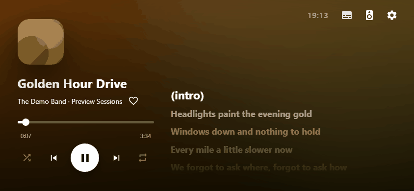

[**Live demo (no Spotify needed)**](https://haidaresber.github.io/nowplaying/?demo) · [Set it up](#set-it-up-10-minutes-free) · [How it works](#how-it-works)

</div>

## Screenshots

| Landscape + lyrics | Landscape, cover only | Arabic / right-to-left |
|---|---|---|
| 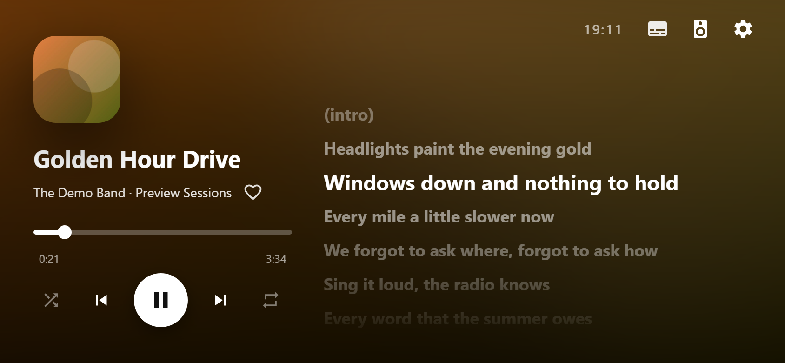 | 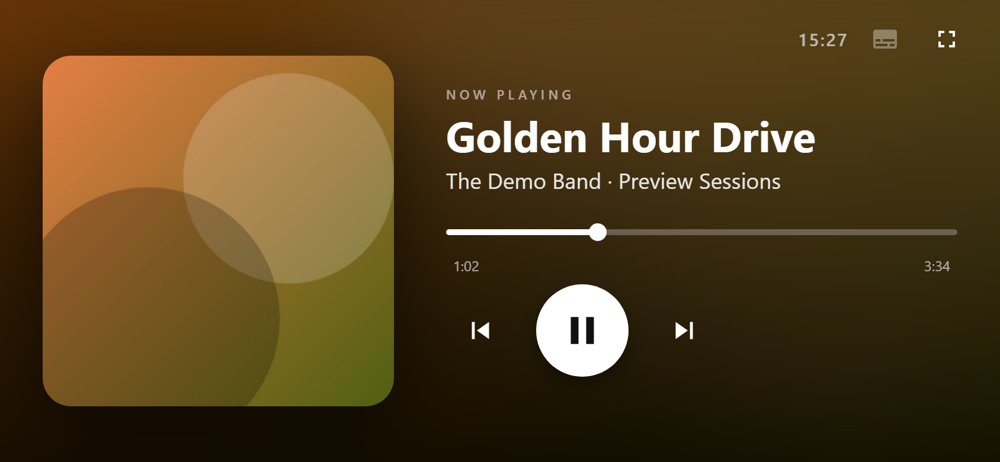 | 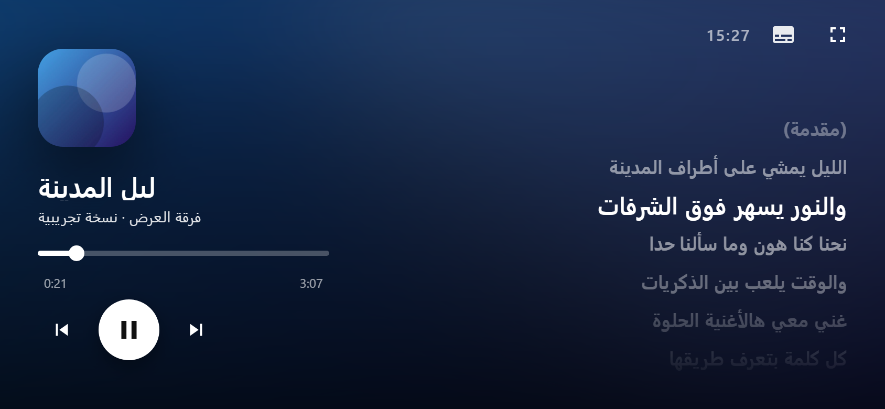 |

| Portrait + lyrics | Portrait, cover only | Connect screen | Idle clock |
|---|---|---|---|
| 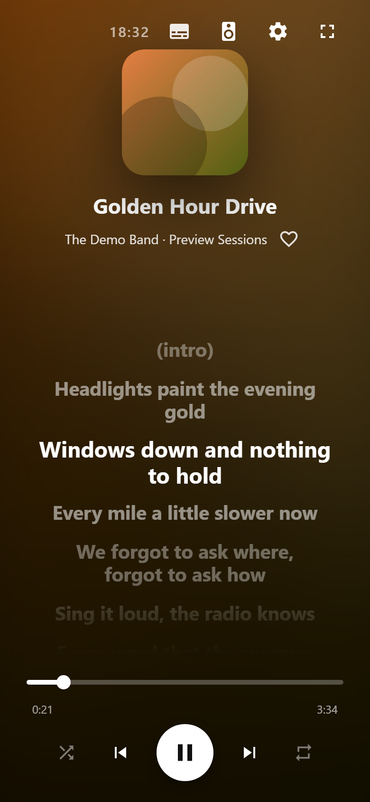 | 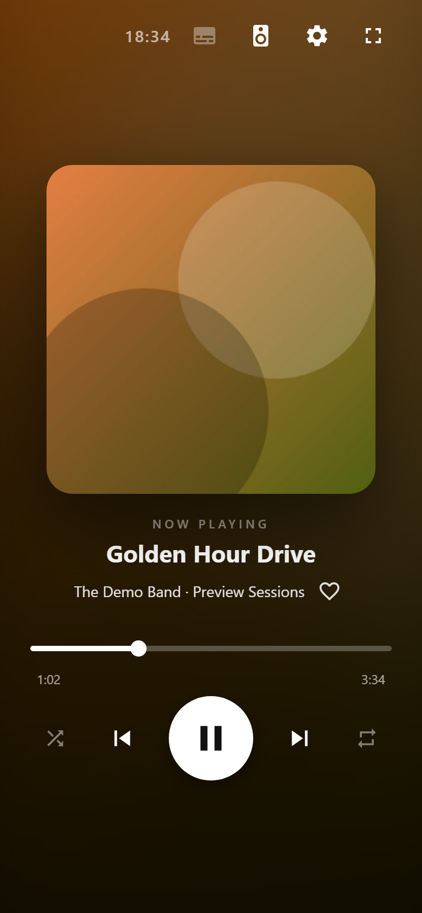 | 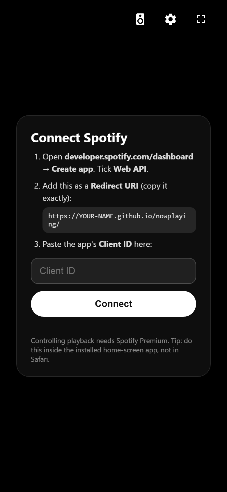 | 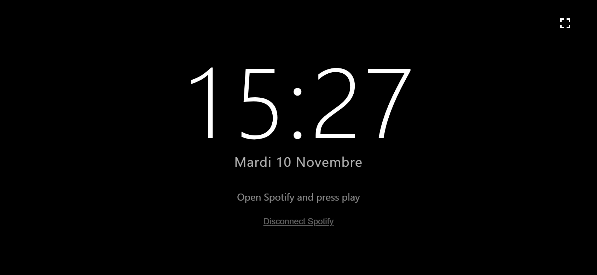 |

| Device switcher | Settings | One line | Word by word |
|---|---|---|---|
| 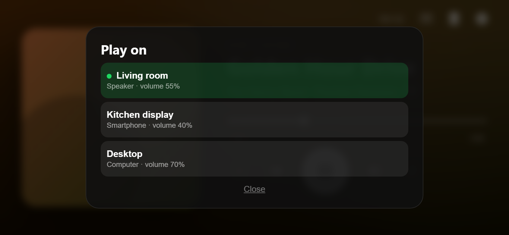 | 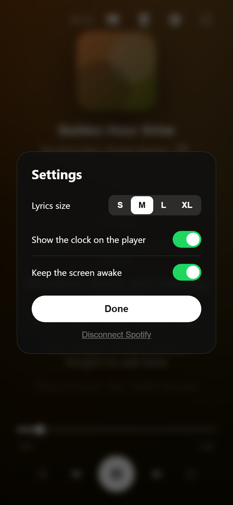 | 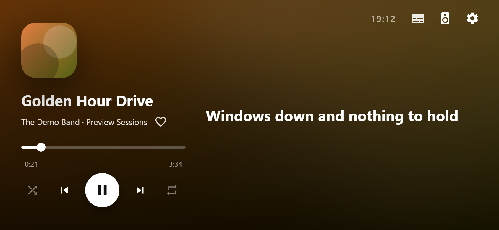 | 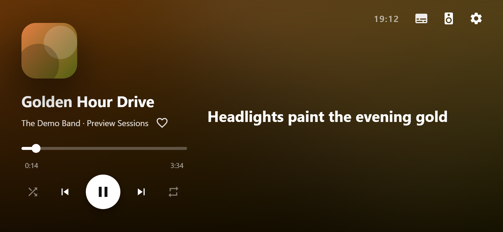 |

*Screenshots use the built-in demo mode (fake songs), so no real artwork is shown.*

## Features

- **Now playing**: cover, title, artist, progress bar, play / pause / next / previous / seek.
- **Shuffle and repeat** (off / all / one) buttons beside the transport controls.
- **Like**: a heart next to the artist adds the song to your Liked Songs, and shows when it already is.
- **Volume**: swipe up or down on the cover (scroll wheel on desktop).
- **Playlists**: the library button in the top bar lists your Spotify playlists; tap one to play it. The same sheet has a **Devices** tab to move playback to any of your Spotify Connect devices.
- **Greets you by name**: the setup asks for your name once (skippable, editable in Settings), then a short "Good evening, name" appears every time you open the app, and on the idle screen.
- **Keyboard shortcuts** on desktop (press **?** for the list): Space play/pause, arrows to seek and change volume, N/B next/previous, M mute, S shuffle, R repeat, L like, T lyrics, Y lyric style, G genre look preview, X replay line animation, F full screen, P playlists, D devices.
- **Five lyric styles** (Settings): **Scroll** (all lines), **Karaoke** (words light up as they're sung), **One line**, **Two lines** (current and next) and **Word by word** (words appear one at a time). LRCLIB only has line timings, so word timing is estimated from word length.
- **Genre looks with expressive line animations**: the song's genre (looked up online: Apple Music search first, then MusicBrainz community tags, then the artist's Spotify genres; Settings shows what was found and where from) picks one of ten looks, and the colours come from the **album cover**. Each look has its own typeface and a set of entrances; every new line picks one at random (never the same twice in a row). Besides each look's four signature entrances, a small animation engine builds **cut-up lines** with random geometry every time, so no two cuts are alike. The pieces fly in tinted with the cover's colours and turn white as they lock onto the text, and they keep Arabic and other joined scripts intact:
  - **Katana**: a bright blade sweeps across, the line is cut along a random diagonal and the halves snap back together with a flash. **X-cut**: two blades, four pieces.
  - **Shatter** (jagged shards assemble), **Tear** (the line rips apart along a jagged edge and slams shut), **Blinds** (strips slide in from alternating sides), **Zipper** (columns drop in), **Glitch bands**, **Split doors**.
  - **Word effects**: chop, wave, swing, pop, one word after another.
  - **Arabic look** (Fairouz, Khaleeji, Egyptian pop, Raï...): a calligraphic Naskh typeface in warm gold and teal, with entrances that start from the right and never stretch letters. It is for traditional and regional Arabic music (Fairouz, tarab, Khaleeji...). The music genre always wins: Arabic pop gets the pop look, Arabic rock the rock look, Arabic rap the hip-hop look (all with the Arabic fonts). Arabic-script songs only get the Arabic look when no genre is found anywhere.
  - Per look: *hip-hop* (slam, stamp, spray, scratch + chop, zipper, katana), *rock* (sliced lines, quake, lightning + katana, X-cut, shatter, tear), *electronic* (glitch, RGB split, scan-in, strobe + glitch bands, shatter), *classical & jazz* (unfold, curtain, ink bleed, falling page + split doors, blinds), *lo-fi & chill* (dream, rise, ripple, drift), *R&B & soul* (velvet slide, heartbeat, silk rise), *country & folk* (handwriting, typewriter, dropped paper, tear), *Latin & reggae* (salsa pop, 3D flip, bouncing drop, confetti pop + shatter), *pop* (bounce, star spin, zoom, jelly + shatter, pop).
  Turn it off in Settings -> Genre animations. Effects freeze while paused and respect "reduce motion". Lines keep a safe margin so no animation is clipped at the edges. Songs with no genre anywhere keep the normal look. **G** previews each look, **X** replays the playing line with the next animation of the current look.
- **Info while the buttons are hidden**: when the buttons fade out, the top of the screen shows "Good evening, name" with the date and time, then rotates through where it's playing and the volume, the album, and the shuffle/repeat state.
- **Arabic done properly**: bundled fonts (Cairo, Amiri, Reem Kufi; SIL Open Font License, in `fonts/`) chosen per look, no letter-stretching, italics or capitals on Arabic lines, and the fonts load before Arabic lyrics appear so nothing shifts mid-line.
- **Auto-hiding buttons**: the top bar, transport buttons and heart fade out after 5 s without a touch. The first tap only brings them back, so you can't press something by accident.
- **Settings**: lyric style and size (S to XL), show or hide the clock, auto-hide, full screen, and keep-screen-awake. Saved in this browser.
- **Synced lyrics** from [LRCLIB](https://lrclib.net) that scroll with the song, big and readable from across the room. Works with right-to-left languages. One lyrics button hides or shows them.
- **Scroll the lyrics yourself**: drag or flick them (mouse wheel on desktop) to read ahead or look back. Auto-scroll pauses, and after a few seconds, or when you tap **Now**, they glide back to the current line.
- **Tap a lyric line to jump there**: Spotify seeks to that line of the song (needs Premium, like the other controls).
- **Colours from the cover**: the background is a blurred wash of the current album art.
- **Layouts for both orientations**, with or without lyrics.
- **Always on**: Screen Wake Lock keeps the display awake, and the app never changes your brightness.
- **Full screen** (Settings -> Full screen; Android, desktop, iPad). On iPhone, install it to the home screen for a bar-free full screen.
- **Idle mode**: a large clock when nothing is playing.
- **Light on the network**: one Spotify request every ~3.5 s while playing, every 8 s when paused, none in the background.
- **Private**: your Spotify login stays in your browser (PKCE, no client secret). The only other request is one lyrics lookup per song.

## Set it up (10 minutes, free)

You need **Spotify Premium** (Spotify only lets Premium accounts control playback) and a GitHub account.

### 1. Get your own copy online

**Option A, one command** (needs the [GitHub CLI](https://cli.github.com), logged in with `gh auth login`):

```bash
./setup.sh          # macOS / Linux / Git Bash
.\setup.ps1         # Windows PowerShell
```

It forks this repo, turns on GitHub Pages and prints your two values: the **site address** and the **Redirect URI**.

**Option B, by hand**: click **Fork**, then in your fork go to *Settings -> Pages -> Deploy from a branch -> `main` / root*.
Your address will be `https://YOUR-NAME.github.io/nowplaying/`.

### 2. Create a Spotify app (the one step that can't be automated)

1. Open the [Spotify developer dashboard](https://developer.spotify.com/dashboard) and choose **Create app**.
2. Name it anything. Tick **Web API**.
3. Under **Redirect URIs**, add your site address *exactly*, including the trailing `/`:
   `https://YOUR-NAME.github.io/nowplaying/`
4. Save, then copy the **Client ID**. (Open your site: the connect screen also shows the exact Redirect URI to copy.)

### 3. Connect

- **iPhone**: open your site in Safari -> Share -> **Add to Home Screen**. Open it **from the home-screen icon**, paste the Client ID, tap **Connect**, and log in to Spotify.
- **Android**: open the site in Chrome, paste the Client ID, tap **Connect**. Optionally *Install app* from the menu.

Start playing in the Spotify app and it appears within a few seconds.

> **Tip:** do the login inside the installed home-screen app on iPhone. Logging in from Safari and then installing means logging in again, because the two don't share storage.

### Try it without Spotify

Add `?demo` to the address. `?demo=idle` and `?demo=setup` show the other screens. Extra knobs for screenshots: `&n=1` (second song), `&t=40` (start at 40 s), `&ly=0` (hide lyrics).

## Troubleshooting

| Problem | Fix |
|---|---|
| "INVALID_CLIENT: Invalid redirect URI" | The Redirect URI in the Spotify dashboard must match the site address exactly (trailing `/`, `https`, same capitalisation). |
| Nothing shows after login | Press play in Spotify first. The web API only reports an active playback device. |
| Buttons do nothing | Controlling playback needs Premium. |
| Playlists say Spotify needs one more permission | Tap **Reconnect Spotify** once and approve the playlist permission. |
| "Pick a device to play on first" | Spotify has no active device. Open Spotify somewhere, or choose one in the Devices tab. |
| The heart asks to reconnect | Likes need two extra Spotify permissions. Tap the heart again (or Settings -> Reconnect) and approve once. |
| Volume swipe says the device sets its own volume | Some devices, such as iPhones running Spotify, don't let other apps change their volume. |
| Screen turns off on iPhone | Screen Wake Lock needs iOS 16.4+, and works best from the home-screen app. |
| Full screen (in Settings) shows a guide on iPhone | Safari can't do real full screen. Use the home-screen app instead. |
| No lyrics for a song | LRCLIB doesn't have every track. The cover layout is used instead. |

## How it works

<p align="center">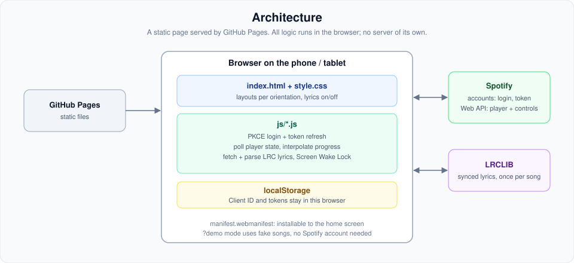</p>

Plain HTML, CSS and JS in three files (`index.html`, `style.css`, `app.js`), no build step.

- **Auth**: Spotify Authorization Code with PKCE. Only your Client ID is stored, in `localStorage`; there is no secret to leak.
- **State**: polls `GET /v1/me/player` and interpolates the progress locally between polls. Controls are `PUT/POST /v1/me/player/*`, with an optimistic play/pause toggle.
- **Lyrics**: LRCLIB `get` with a `search` fallback, parsed from LRC, scrolled with the DOM.
- **Layout**: CSS grid areas per orientation, with and without lyrics.

## Limits

- A web page cannot hear other apps' audio, so there is no audio-reactive equalizer here. (The Android sibling app has one.)
- Spotify only. The web API needs the Spotify app (or another Spotify Connect device) to be playing.
- iPhone Safari has no real full screen, only the home-screen route above.

## Privacy

No analytics, no cookies, no server of mine. Requests go to Spotify (to play/control) and LRCLIB (lyrics). To pick the genre look it also sends the artist and song title to Apple's public iTunes Search and to MusicBrainz (and may ask Spotify for the artist's genres); results are cached in your browser. Turn **Genre animations** off in Settings to stop those lookups. Your Spotify tokens never leave your browser.

## License

MIT. See [LICENSE](LICENSE). Not affiliated with Spotify. Spotify is a trademark of Spotify AB.

## Fonts

Arabic lyrics use Cairo, Amiri and Reem Kufi, bundled in `fonts/` (no requests to font servers). All three are licensed under the SIL Open Font License 1.1; the licence texts are next to the files.
